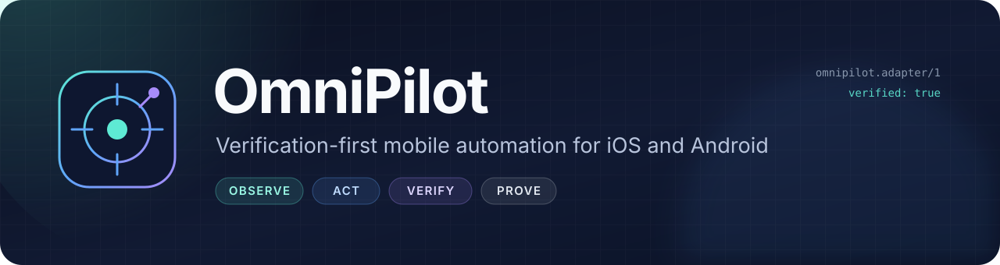
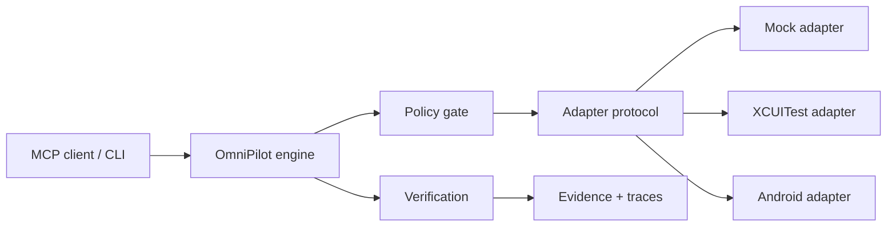

<p align="center">
  
</p>

<h1 align="center">OmniPilot</h1>

<p align="center">
  <strong>AI agents can tap. OmniPilot can prove it worked.</strong>
</p>

<p align="center">
  Verification-first mobile automation for iOS and Android.<br/>
  Native APIs. Local-first. MCP-native. Open source.
</p>

<p align="center">
  <a href="https://github.com/Mullassery/OmniPilot/actions/workflows/rust.yml"></a>
  
  
  
  
  
  
</p>

> **Alpha, built in public.** The Rust engine, CLI, MCP server, and verified mock
> demo work today. The iOS demo app, XCUITest harness, and long-lived iOS adapter
> pass on an iPhone 17 simulator. The Android adapter, physical-device runner,
> and planner are the next milestones. This README is honest about that line.

## Why OmniPilot?

Mobile agents are easy to demo and hard to trust.

An action can return “success” while the app is on the wrong screen. A test can
pass while the feature is broken. An agent can claim it booked the ride, sent the
message, or changed the setting without producing a single piece of evidence.

OmniPilot treats automation as a closed loop:

```text
observe -> authorize -> act -> observe -> verify -> prove
```

A task is **not** `verified` because an action executed. It is verified only when
fresh post-action evidence satisfies explicit success criteria. If there are no
criteria, OmniPilot says the task is unverified instead of pretending.

## What makes it different

| Principle | What it means |
| --- | --- |
| **Verification-first** | Every task ends in assertions against a fresh observation, with evidence stored for inspection. |
| **Native, not brittle** | iOS uses XCUITest; Android will use UI Automator. No OCR-only guessing, no OS bypasses. |
| **MCP-native** | Device discovery, observation, logs, task execution, cancellation, and evidence are exposed as MCP tools. |
| **Local-first** | The engine, adapters, and evidence stay on your machine. No mandatory cloud or paid model. |
| **Typed plans** | Actions and assertions are a versioned schema. The engine can validate, gate, and replay them. |
| **Honest capabilities** | Unsupported actions are reported as unsupported. There is no silent degradation. |
| **Policy gate** | UI mutations are allowed by default; app allowlists and approval gates restrict risky work. |
| **No shell escape hatch** | OmniPilot exposes device operations it can model and verify, not arbitrary shell commands. |

## Use cases

OmniPilot is for workflows where an action returning “success” is not enough.
The common pattern is: a typed plan runs, the adapter acts, the engine captures a
fresh observation, and the result includes evidence that can be inspected later.

| Use case | Who it helps | Proof it produces | Available today |
| --- | --- | --- | --- |
| AI agents that must prove completion | Agent and assistant builders | Final hierarchy, screenshot, assertion result, trace | Mock and opt-in iOS via MCP |
| iOS release smoke tests | iOS QA and release engineers | Deterministic step results plus screenshots and hierarchy | iOS simulator |
| Flaky UI test triage | QA and app developers | Failed assertion next to the actual final screen state | Mock and iOS |
| UI contract and identifier coverage | Mobile platform teams | Role, label, value, identifier, bounds, enabled, clickable | iOS |
| Privacy-sensitive local automation | Regulated and security-conscious teams | Local evidence, loopback-only transport, policy decisions | Mock and iOS CLI |
| MCP tooling for coding assistants | Developers using MCP clients | Task records, logs, and evidence through MCP tools | Mock and opt-in iOS simulator |
| Adapter conformance and Android expansion | Platform and adapter engineers | Shared protocol tests and engine behavior across adapters | Mock and iOS; Android planned |
| Evidence-rich bug reports | Support, QA, and engineering | Reproducible task result with screenshots, hierarchy, and trace | Mock and iOS |
| Agent evaluation sandbox | AI researchers and evaluators | Repeatable task outcomes without device flakiness | Deterministic mock |
| Approval-gated automation | Teams with risky or restricted flows | Explicit allow/deny decisions before actions execute | Engine and policy today |

### 1. AI agents that must prove a mobile task

An assistant is asked to change a notification setting, finish onboarding, or
update a test-account profile. Returning “done” after a tap is not acceptable.

OmniPilot takes a typed plan, applies policy, drives the app through the adapter,
captures a fresh final observation, and evaluates explicit success criteria. The
agent gets a task result plus evidence instead of an unverifiable claim.

**Example:** launch the demo app, open Settings, toggle dark mode, and require
the dark-mode value to be `On` (or the iOS text `Dark mode is On`).

**Today:** both adapters are available through MCP. Start the server with
`--ios --ios-device <udid>` to add the iOS simulator; `ios-demo` and
`run --platform ios` remain the direct CLI path.

### 2. iOS release smoke tests

Before a TestFlight build or release candidate, a team wants to check the few
flows that must never break: sign-in, onboarding, settings, password reset, or a
test-account checkout path.

Instead of maintaining a large brittle script, the team runs a short typed plan
against the simulator and asserts the end state. The result is a pass/fail with
screenshots and hierarchy attached.

**Example:** verify that a settings change persists and that the confirmation
screen is actually visible, not merely that the tap returned successfully.

**Today:** `omnipilot ios-demo` and `run --platform ios` run on an iOS simulator
and write evidence under `traces/<task_id>/`.

### 3. Flaky UI test triage

A UI test fails intermittently. The useful question is not “which line failed?”
but “what was actually on screen, which elements existed, and what did the app
log?”

OmniPilot records the final observation next to the failed assertion, including
screenshots, hierarchy snapshots, step results, and an event trace. A developer
can see whether the app was on the wrong screen, missing an element, or slow to
update. Adapter logs remain available through the protocol's `logs` method.

**Example:** an assertion expects `Dark mode is On`, but the final hierarchy
still says `Dark mode is Off`; the attached screenshot shows the toggle never
moved.

**Today:** works with the mock adapter and the iOS simulator adapter.

### 4. UI contract and identifier coverage

Automation breaks when accessibility identifiers are renamed, labels disappear,
or controls become non-hittable. Teams can use OmniPilot observations as a UI
contract check before those regressions reach a test suite.

An observation includes each element’s role, label, value, identifier, bounds,
enabled state, and clickability. A task can assert that required elements exist
and that the expected text is present.

**Example:** catch a renamed `settings.dark_mode` identifier before a release
test fails on the device.

**Today:** available through iOS hierarchy observations. This is a UI contract
check, not a full accessibility compliance audit.

### 5. Privacy-sensitive local automation

Some teams cannot send screenshots, hierarchy, or app state to a cloud service.
They need automation and evidence to stay on the local machine.

OmniPilot runs the engine, adapter, and evidence store locally. The adapter uses
a loopback-only connection with a per-session token, and the protocol has no
arbitrary shell command. Policy decisions are recorded in the task flow.

**Example:** a regulated team runs a simulator smoke test on a build machine and
keeps the resulting screenshots and hierarchy in its own evidence directory.

**Today:** local mock and iOS simulator paths through the CLI and MCP.
Physical-device support is still ahead.

### 6. MCP tooling for coding assistants

A coding assistant needs to inspect the device, observe the current screen, run
a task, check logs, and retrieve evidence without a custom integration for every
tool.

The MCP server exposes eight tools: `list_devices`, `get_capabilities`,
`observe`, `get_logs`, `run_task`, `get_task`, `cancel_task`, and `get_evidence`.
`run_task` requires explicit typed steps and/or success criteria.

**Example:** an assistant calls `observe`, proposes a typed plan, runs it, polls
`get_task`, and fetches the screenshot evidence for the final state.

**Today:** the MCP server exposes the mock adapter by default and an opt-in iOS
simulator adapter. Start it with `--ios --ios-device <udid>`.

### 7. Adapter conformance and Android expansion

Adding a platform should not require rewriting the engine, policy, verification,
or evidence model. A new adapter only needs to implement the same versioned
protocol and device contract.

The mock adapter is the deterministic reference. The iOS adapter is the first
real-platform implementation. Both run through the same executor, assertions,
retry logic, cancellation, and evidence store.

**Example:** build an Android UI Automator adapter that speaks the same NDJSON
protocol, then reuse the existing engine and task schema.

**Today:** mock and iOS are working; Android is planned and still needs the JDK,
Android SDK, `adb`, and an emulator.

### 8. Evidence-rich bug reports

A support engineer reproduces a bug and needs to hand it to an app developer with
more than “it failed on my machine.”

A task result includes a task ID, step outcomes, assertion results, evidence
references, and a trace. The evidence directory contains the screenshots and
hierarchy snapshots captured during the run; adapter logs are available through
the protocol's `logs` method.

**Example:** attach the task ID and the final screenshot/hierarchy to an issue so
the developer can see the exact state that failed.

**Today:** available with the mock adapter and the iOS simulator adapter.

### 9. Agent evaluation sandbox

Evaluating a mobile agent is noisy when every run depends on a simulator, a
network, or a flaky app. The deterministic mock adapter provides a stable
environment for testing tool use and verification behavior.

An evaluator can run the same typed plan repeatedly, assert the same outcome,
and inspect traces without device variance. The mock is explicitly not a real
phone, which keeps the evaluation honest.

**Example:** check that an agent emits a valid typed plan, respects policy, and
does not claim success when the final assertion fails.

**Today:** the mock adapter and `omnipilot demo` work without Xcode.

### 10. Approval-gated automation

Some UI actions are safe in a test account but unacceptable in production, or
require a human decision before they run. Policy should be enforced before the
device is touched.

The policy gate supports app allowlists and risk approval. A denied action
produces a blocked task instead of a silent attempt. Approved risks can be
passed explicitly for a task.

**Example:** allow UI mutations only for `com.omnipilot.demo`, or require
approval before a flow that changes account settings.

**Today:** the engine and policy gate work with mock and iOS tasks. A review UI
and natural-language planner are future work.

### Availability note

The verified real-platform path in this alpha is the iOS simulator adapter.
Android, physical iOS devices, and natural-language planning are not finished
yet. The mock adapter remains the deterministic default; start MCP with `--ios`
to add the simulator adapter.

## See it work

The built-in mock scenario runs through the real engine:

```console
$ target/release/omnipilot demo

task:      1c9fd18a-800b-44b6-82db-26885bceea75
status:    completed
verified:  true
summary:   Completed and verified 2 success criteria.
  step 01  launch_app       executed   launched com.omnipilot.demo
  step 02  tap              executed   opened Settings
  step 03  tap              executed   dark mode is now On
  assert    PASS       element value was On
  assert    PASS       text was present: Dark mode
evidence:  7 item(s)
duration:  0 ms
```

The engine launched the app, performed the actions, captured a new observation,
and only then marked the task verified.

The same loop runs against a real iOS simulator through the XCUITest adapter:

```console
$ target/release/omnipilot ios-demo

task:      4e15b9b3-1f98-4c1c-8cfc-4e7fe857cddb
status:    completed
verified:  true
summary:   Completed and verified 1 success criterion.
  step 01  launch_app       executed   launched com.omnipilot.demo
  step 02  tap              executed   tapped identifier=home.settings
  step 03  tap              executed   tapped identifier=settings.dark_mode
  assert    PASS       text was present: Dark mode is On
evidence:  4 item(s)
duration:  6079 ms
```

`ios-demo` launches `xcodebuild`, connects to the loopback adapter, runs the
typed plan through the engine, verifies the fresh hierarchy, and shuts the runner
down.

## Quickstart

```bash
git clone https://github.com/Mullassery/OmniPilot.git
cd OmniPilot

cargo build --release --workspace
cargo test --workspace

target/release/omnipilot demo
target/release/omnipilot doctor
target/release/omnipilot protocol schema

# iOS (requires Xcode 26+ and a simulator)
target/release/omnipilot ios-devices
target/release/omnipilot ios-boot --device <simulator-udid>
target/release/omnipilot ios-shutdown --device <simulator-udid>
target/release/omnipilot ios-demo
```

Requirements: Rust 1.90+ and macOS for the Apple tooling. Xcode 26+ is required
for the iOS demo, UI tests, and XCUITest adapter. The host falls back to
`/Applications/Xcode.app/Contents/Developer` when `xcode-select` points at
Command Line Tools.

## MCP

Build the release binary, then register it with your MCP client. This default
configuration exposes the mock adapter:

```json
{
  "mcpServers": {
    "omnipilot": {
      "command": "/absolute/path/to/OmniPilot/target/release/omnipilot",
      "args": ["mcp"]
    }
  }
}
```

To expose a booted iOS simulator as well, add the opt-in flags. The server
launches the XCUITest adapter before accepting MCP requests:

```json
{
  "mcpServers": {
    "omnipilot-ios": {
      "command": "/absolute/path/to/OmniPilot/target/release/omnipilot",
      "args": ["mcp", "--ios", "--ios-device", "<simulator-udid>"]
    }
  }
}
```

`list_devices` then returns both the mock and iOS devices. `run_task` infers the
platform from `device_id`, so passing the simulator UDID is enough. Use
`--ios-destination` to override the whole `xcodebuild` destination.

Available tools:

`list_devices` · `get_capabilities` · `observe` · `get_logs` · `run_task` ·
`get_task` · `cancel_task` · `get_evidence`

`run_task` requires explicit typed steps and/or success criteria. Natural-language
planning is intentionally not enabled yet; when it arrives, plans will be
reviewable before execution.

## Apple-first status

| Area | Today | Next |
| --- | --- | --- |
| Rust engine, CLI, MCP | Working | Packaging and install polish |
| Mock adapter | Verified demo | Adapter conformance suite |
| iOS demo app | SwiftUI screens with stable identifiers | — |
| iOS UI tests | 2 tests passing on iPhone 17 | More flow coverage |
| iOS simulator lifecycle | `ios-boot` and `ios-shutdown` | Device-pool automation |
| iOS adapter | `ios-demo` and `run --platform ios` verified with evidence | Physical-device runner and broader action coverage |
| MCP iOS adapter | Opt-in `mcp --ios --ios-device <udid>` verified with evidence | Packaging and client examples |
| iOS device build | Compiles with signing disabled | Provisioned device runner |
| Android | Planned | UI Automator adapter + `adb` lifecycle |
| Planner | Typed plans only | Natural-language planner with approval |

The iOS adapter is real: it launches an XCUITest runner, speaks the versioned
NDJSON protocol over loopback, and returns hierarchy/screenshot evidence to the
engine. The MCP server exposes the mock runtime by default and can launch the
same iOS adapter with `--ios --ios-device <udid>`. See
[docs/APPLE.md](docs/APPLE.md) for commands and limitations.

## Architecture



The engine owns retries, budgets, cancellation, assertions, and final status.
Adapters only perform native device operations and report what actually happened.
The wire protocol is versioned JSON-RPC 2.0 over newline-delimited JSON with a
per-session token and handshake-before-use.

Read more:

- [Architecture](docs/ARCHITECTURE.md)
- [Protocol](docs/PROTOCOL.md)
- [Apple build and iOS scope](docs/APPLE.md)
- [Roadmap](docs/ROADMAP.md)
- [Upstream provenance](docs/UPSTREAM.md)

## Repository layout

```text
crates/omnipilot-core      Domain models, errors, tasks, results, evidence
crates/omnipilot-protocol  JSON-RPC contract, NDJSON transport, schema
crates/omnipilot-engine    Policy, executor, verification, traces, evidence
crates/omnipilot-mock      Deterministic mock device and demo scenario
crates/omnipilot-ios       XCUITest process lifecycle and iOS adapter host
crates/omnipilot-cli       omnipilot command-line interface
crates/omnipilot-mcp       MCP stdio server
apple/                     XcodeGen spec, SwiftUI demo, XCUITest harness
docs/                      Architecture, protocol, Apple notes, roadmap, upstream
traces/                    Runtime evidence and event logs (gitignored)
```

## Roadmap

- [x] Versioned core models and adapter protocol.
- [x] Verification-first executor with policy, retries, cancellation, and traces.
- [x] Mock adapter, CLI, MCP server, and integration tests.
- [x] Apple-first build: macOS host, iOS demo, passing XCUITest harness.
- [x] Long-lived XCUITest protocol adapter over loopback.
- [x] End-to-end iOS task with fresh observation and evidence.
- [x] MCP wiring for the iOS simulator adapter.
- [x] Simulator boot/shutdown lifecycle (`ios-boot`, `ios-shutdown`).
- [ ] Physical-device runner.
- [ ] Android UI Automator adapter.
- [ ] Natural-language planner with reviewable plans.
- [ ] CI for Apple and Android, packaged releases, and client examples.

## Design constraints

OmniPilot is deliberately not:

- an unrestricted shell or OS bypass;
- a device-fleet manager;
- a desktop GUI;
- a cloud-only service;
- a system that calls an action “verified” without fresh evidence.

## Contributing

The project is early and the architecture is intentionally small. Open an issue
before large changes, keep adapters honest about capabilities, and include a
verification path for every new action.

If you want mobile agents that can prove their work, star the repo and follow the
build.

## License and attribution

Apache License 2.0. See [LICENSE](LICENSE) and [NOTICE](NOTICE).

OmniPilot is an independent open-source project. Third-party attribution and
provenance records are retained in [NOTICE](NOTICE) and
[docs/UPSTREAM.md](docs/UPSTREAM.md).
